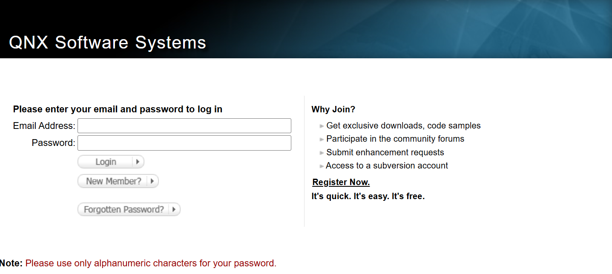
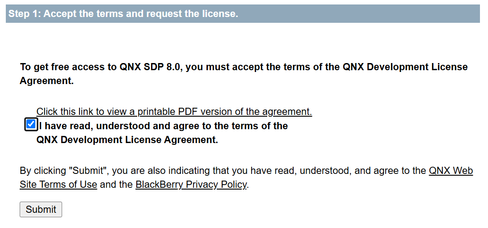
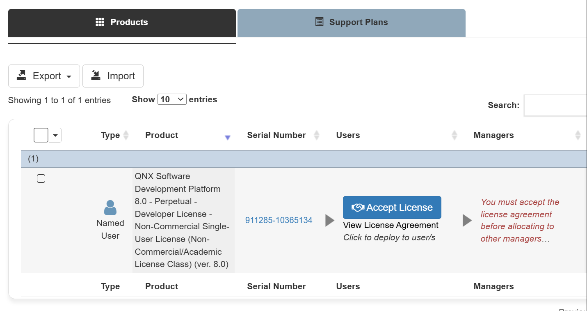
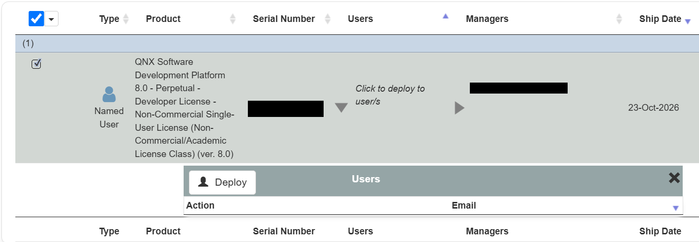
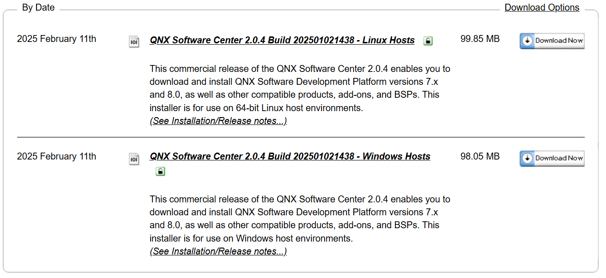
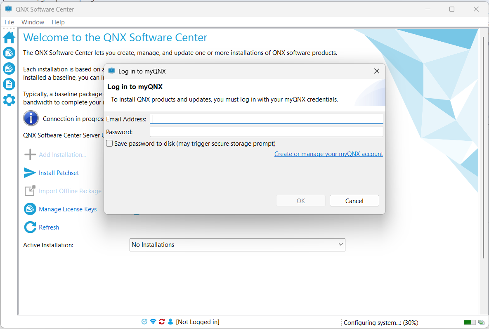
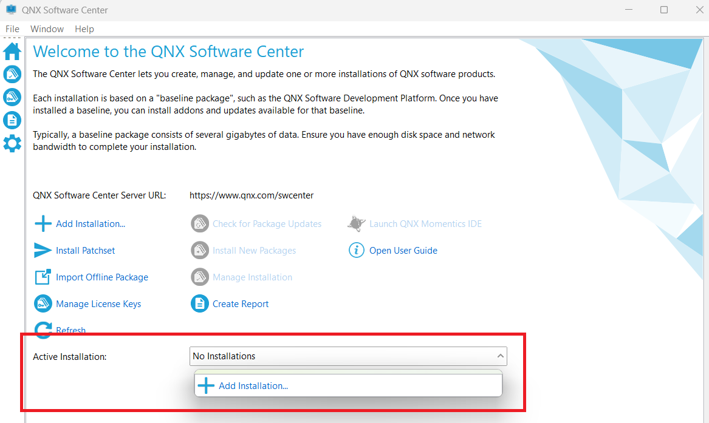
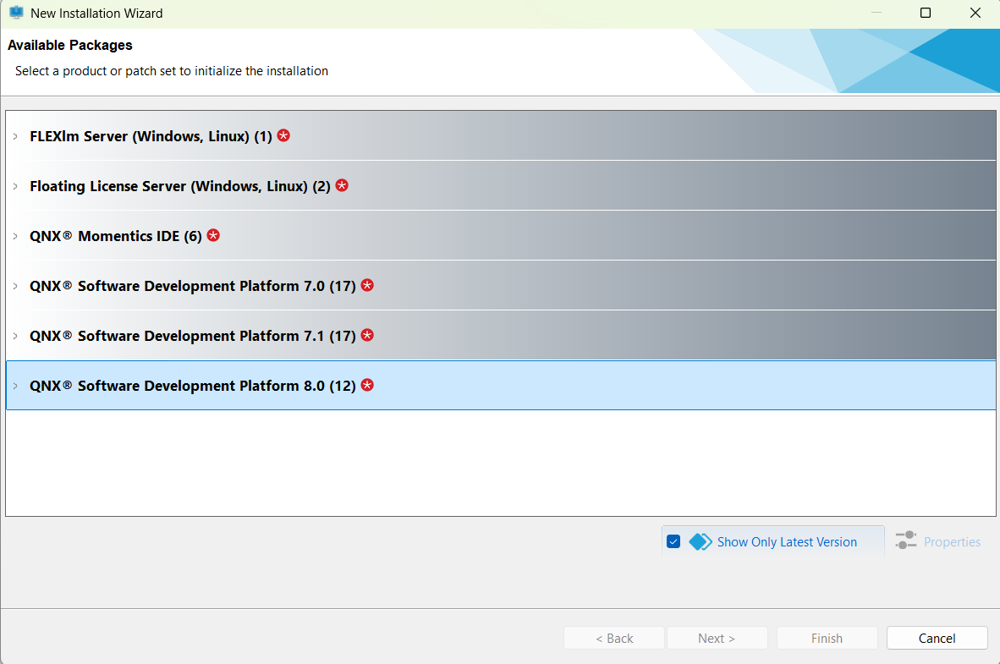
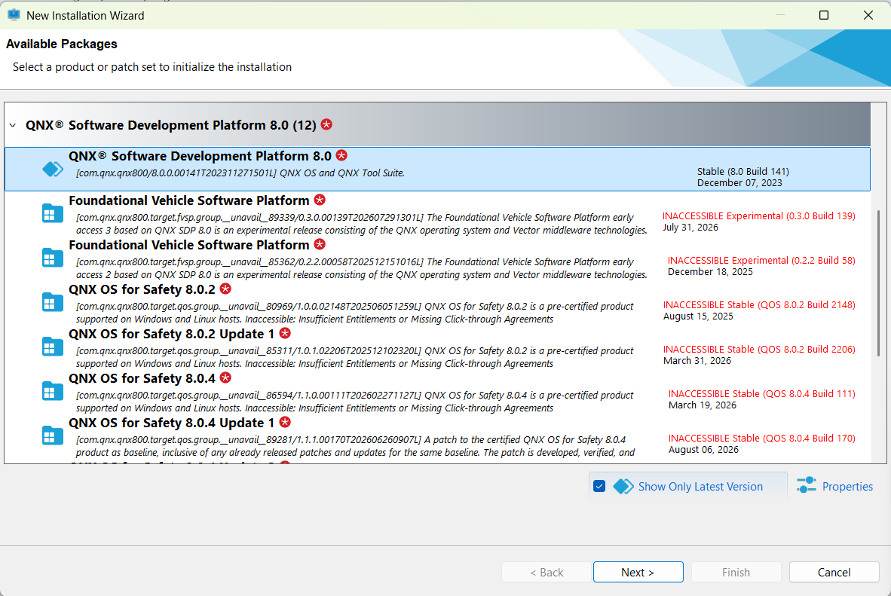
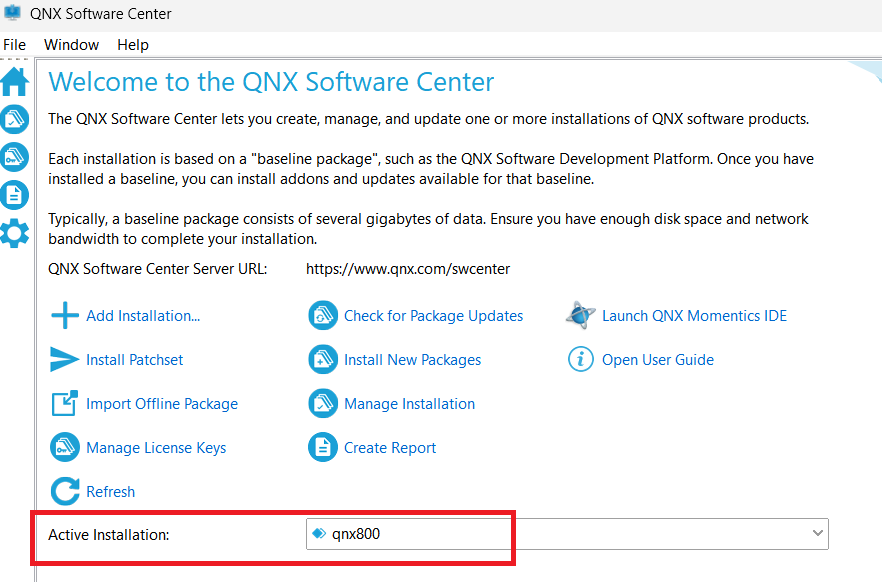

# Download QNX Software Development Platform (SDP) 8.0

In order to develop and compile C programs for QNX, you first need to download the **QNX Software Development Platform**. 

You will need a myQNX account with a valid QNX SDP 8.0 license deployed to it before you can access and use the software.

## Supported Host Operating Systems
According to the [QNX SDP 8.0 Release Notes (June 25, 2026)](https://www.qnx.com/developers/docs/relnotes8.0/com.qnx.doc.release_notes/topic/8.0.5_prod_release_notes/8.0.5_rn.html), QNX SDP 8.0 is officially supported on the following 64-bit operating systems:
- Windows: Windows 11
- Linux: Ubuntu Desktop 22.04 LTS, Ubuntu Desktop 24.04 LTS, and Red Hat Enterprise Linux 9
- macOS: Not officially supported

**Note:** QNX SDP 8.0 is not supported on host systems that use ARM processors.

## 1. Create a myQNX account

Please create and login to your myQNX account here: https://www.qnx.com/account/login.html

**Note:** It may take up to 5 minutes to receive your account's confirmation code, so don't worry if it doesn't arrive immediately.

## 2. Get your license
### 2.1. Apply for a license
Apply for a QNX Software Development Platform 8.0 license for non-commercial use here: https://www.qnx.com/products/everywhere/

### 2.2. Deploy your license
Once you receive a confirmation email from QNX for your license, please go to your dashboard here: https://www.qnx.com/account/dashboard/

- Click `Accept License`.

- In the `Users` column, click `Click to deploy to user/s`.
- Click `Deploy`.
- Enter your own account email address to deploy the license to yourself.
- Click `Save`.

## 3. Download QNX Software Center
After deploying the license, you can access the QNX Software Center and use it to install QNX SDP 8.0.

- You can download the QNX Software Center here: https://www.qnx.com/download/group.html?programid=29178
- Choose and download the appropriate installer found at the bottom of the QNX Download Center page.
- Open the installer and follow all installation prompts on the screen.

## 4. Download QNX SDP 8.0
After installing the QNX Software Center, you are ready to install QNX SDP 8.0.

### 4.1. Open QNX Software Center
On your device, open the QNX Software Center and log in with your myQNX account.

### 4.2. Add a new installation
Open the `Active Installation` dropdown and add a new installation.

### 4.3. Download QNX SDP 8.0
- Select the <code>QNX Software Development Platform 8.0 (12)</code> option in the <code>Available Packages</code>

- Select the <code>QNX Software Development Platform 8.0</code> option in the dropdown.

- Click <code>Next</code> and follow all installation prompts on the screen.

### 4.4. Verify your download
Go back to the home screen of the **QNX Software Center**. 

You should see the package name `qnx800` in the `Active Installation` dropdown if it was installed correctly.

