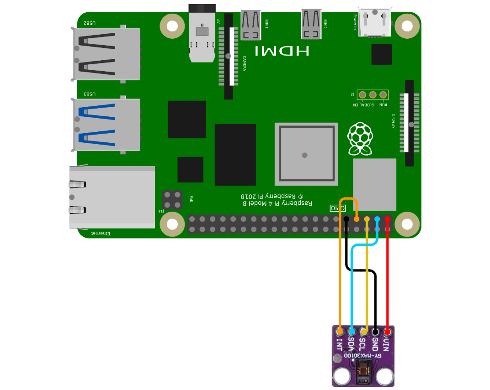
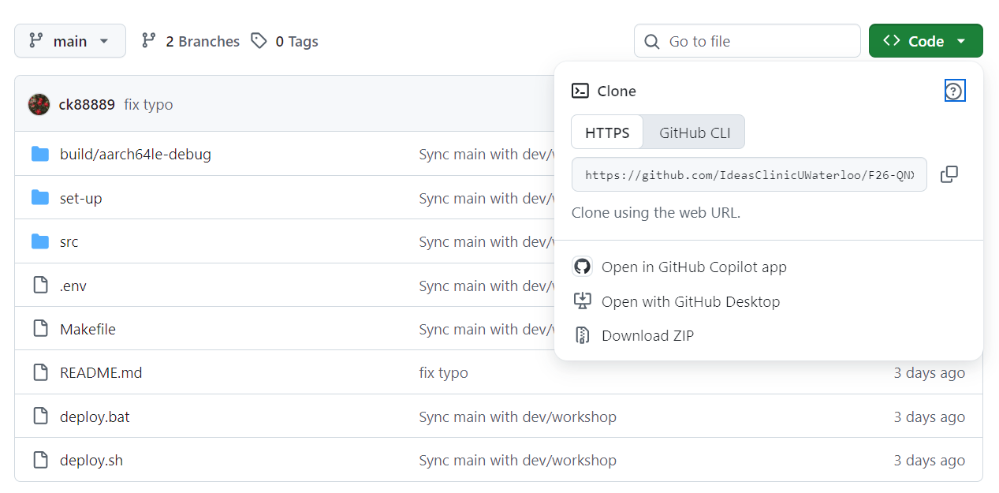

# Set Up Your Project
## Overview

Use the links below to jump to each section:

- [1. Building the Circuit](#1-building-the-circuit)
- [2. Download Project Files](#2-download-project-files)
- [3. Setting Up the Development Environment](#3-setting-up-the-development-environment)
- [4. Compile Code for QNX](#4-compile-code-for-qnx)
  - [4.1. Configure the Raspberry Pi IP Address](#41-configure-the-raspberry-pi-ip-address)
  - [4.2. Open Development Terminal](#42-open-development-terminal)
  - [4.3. Compile Your Code](#43-compile-your-code)
  - [4.4. Deploy Your Code to the Raspberry Pi](#44-deploy-your-code-to-the-raspberry-pi)
- [5. SSH Into Your Raspberry Pi](#5-ssh-into-your-raspberry-pi)
  - [5.1. Establish a Network Connection](#51-establish-a-network-connection)
  - [5.2. Connect to Raspberry Pi via SSH](#52-connect-to-raspberry-pi-via-ssh)
  - [5.3. Switch to Root User](#53-switch-to-root-user)
  - [5.4. Run the Programs](#54-run-the-programs)
  - [5.5. Stop the Programs](#55-stop-the-programs)
- [Making and Testing Code Changes](#making-and-testing-code-changes)


## 1. Building the Circuit

Please build the following circuit for this workshop.

<p align="center">
  
</p>


## 2. Download Project Files

**2.1.** Go to the [main page](https://github.com/IdeasClinicUWaterloo/F26-QNX-Workshop/tree/main) of this GitHub repository and click the green **<> Code** button to either download it as a ZIP file or clone the repository. Remember to extract the ZIP if downloaded.



**2.2.** Open the project folder in your preferred code or text editor (e.g., Visual Studio Code).

**2.3.** Locate the `src` folder in your editor's file explorer. **All source code for this project is located here.**


## 3. Setting Up the Development Environment

For this workshop, you will use **two terminals**:

1. **Development Terminal:** Used to **compile** your code and **transfer** the compiled files from your computer to the Raspberry Pi.
2. **Raspberry Pi Terminal:** Used to connect to the Raspberry Pi via SSH and **run** your code.

The following sections will guide you through setting up each terminal.


## 4. Compile Code for QNX

### 4.1. Configure the Raspberry Pi IP Address
Open the `.env` file located in this project's directory and replace the value of `RPI_IP_ADDR` with your Raspberry Pi's IP address that is written on its case.

The file should look like: 

```env
RPI_IP_ADDR=<your-rpi-ip-address>
RPI_USER=qnxuser
BUILD_DIR=build/aarch64le-debug
```

### 4.2. Open Development Terminal

Open a **terminal** on your computer and navigate to this project's directory. If you are using Visual Studio Code, you can open an integrated terminal by selecting **Terminal**.

### 4.3 Compile your code

First, verify that the QNX compiler is available:

```bash
qcc -V
```

Then build the project:

```bash
make
```

### 4.4. Deploy your code to the Raspberry Pi

After compiling successfully, run the deployment script which will copy the compiled programs to the Raspberry Pi.

#### Windows
Run:

```powershell
.\deploy.bat
```

#### Linux:

Run:

```bash
./deploy.sh
```

When prompted for the Raspberry Pi user's password, enter:

```text
qnxuser
```

**Note:** No characters will appear on the screen while you type your password. This is normal.


## 5. SSH Into Your Raspberry Pi

SSH allows you to remotely control the Raspberry Pi running QNX from your computer.

### Before you start, make sure:
- The Raspberry Pi is powered on.
- QNX 8.0 has finished booting.
- You have an Ethernet cable or access to the UW-Lab Wi-Fi network.
- You know the IP address of the Raspberry Pi you want to connect to (recall that the Raspberry Pi's IP address is written on its case)

For this workshop, the default QNX username and password are:

**Username**: `qnxuser`

**Password**: `qnxuser`

### 5.1. Establish a Network Connection
#### Option 1: Wi-Fi Connection

Connect your computer to the `UW-Lab` Wi-Fi network.

**Password:** `LeZPjTCXW89hufgX`

#### Option 2: Ethernet Connection (If Wi-Fi Is Not Working)

If you cannot connect to the Raspberry Pi through Wi-Fi, you can use an Ethernet cable to establish a direct connection between your computer and the Raspberry Pi.

**Note:** If your computer does not have an Ethernet port, you will need a USB-to-Ethernet adapter.

1. Connect one end of the Ethernet cable to the Raspberry Pi's Ethernet port.
2. Connect the other end to your computer's Ethernet port. If you are using a USB-to-Ethernet adapter, connect the cable to the adapter and plug the adapter into your computer.
3. Wait for the Ethernet connection to establish.

### 5.2. Connect to Raspberry Pi via SSH

#### Windows

Open the terminal and make sure that you are using PowerShell or Command Prompt.

If you are using Visual Studio Code, you can open an integrated terminal by selecting **Terminal**. 

Run:
```bash
ssh -m hmac-sha2-256 qnxuser@<Raspberry_Pi_IP>
```
For example, if your Raspberry Pi's IP address is 10.37.87.53, run:
```bash
ssh -m hmac-sha2-256 qnxuser@10.37.87.53
```
If this is the first time connecting to the Raspberry Pi, you may see:
```text
Are you sure you want to continue connecting (yes/no/[fingerprint])?
```
Enter:
```text
yes
```
When prompted for a password, enter:
```text
qnxuser
```
If the connection is successful, you should see:
```text
Welcome to QNX 8.0!
```
and a prompt similar to:
```text
qnxuser@qnxpi:~$
```

#### Linux

Open a terminal. 

If you are using Visual Studio Code, you can open an integrated terminal by selecting **Terminal**. 

Run:
```bash
ssh -m hmac-sha2-256 qnxuser@<Raspberry_Pi_IP>
```
For example, if your Raspberry Pi's IP address is 10.37.87.53, run:
```bash
ssh -m hmac-sha2-256 qnxuser@10.37.87.53
```
If this is the first time connecting to the Raspberry Pi, you may see:
```text
Are you sure you want to continue connecting (yes/no/[fingerprint])?
```
Enter:
```text
yes
```
When prompted for a password, enter:
```text
qnxuser
```
If the connection is successful, you should see:
```text
Welcome to QNX 8.0!
```

### 5.3. Switch to Root User
Now that you are connected to the Raspberry Pi, you will need **root privileges** to access certain hardware interfaces, such as I2C, which is used to communicate with the pulse oximeter.

From the terminal, enter:

```bash
su -
```

When prompted, enter the password:

```bash
root
```

**Note:** Keep this terminal open throughout the workshop. You will use it to run and test your programs.

### 5.4. Run the programs
After switching to the root user, navigate to the directory where the deployed programs are located:

```bash
cd /home/qnxuser
```

Start the alarm manager in the background:

```bash
./alarm-manager &
```

Then start the pulse oximeter:

```bash
./pulse-oximeter
```

### 5.5. Stop the programs

To stop both programs manually, run:

```bash
slay pulse-oximeter
slay alarm-manager
```

## Making and Testing Code Changes

Throughout the workshop, you will repeat the following workflow whenever you modify your code:

1. **Edit:** Make changes to the source code in the `src` folder.
2. **Compile:** Run `make` in your development terminal.
3. **Deploy:** Run `deploy.bat` or `deploy.sh` to transfer the updated program.
4. **Run:** Switch to your Raspberry Pi terminal and run:

   ```bash
   ./alarm-manager &
   ./pulse-oximeter
   ```
6. **Test:** Observe the output and verify that your changes work as expected.
7. **Stop:** Press `Ctrl + C` to stop the pulse oximeter. If the alarm manager is still running, run:

   ```bash
   slay alarm-manager
   ```
   
**Remember:** You do not need to reconnect to the Raspberry Pi every time you make a change. Keep both terminals open and switch between them as needed.
